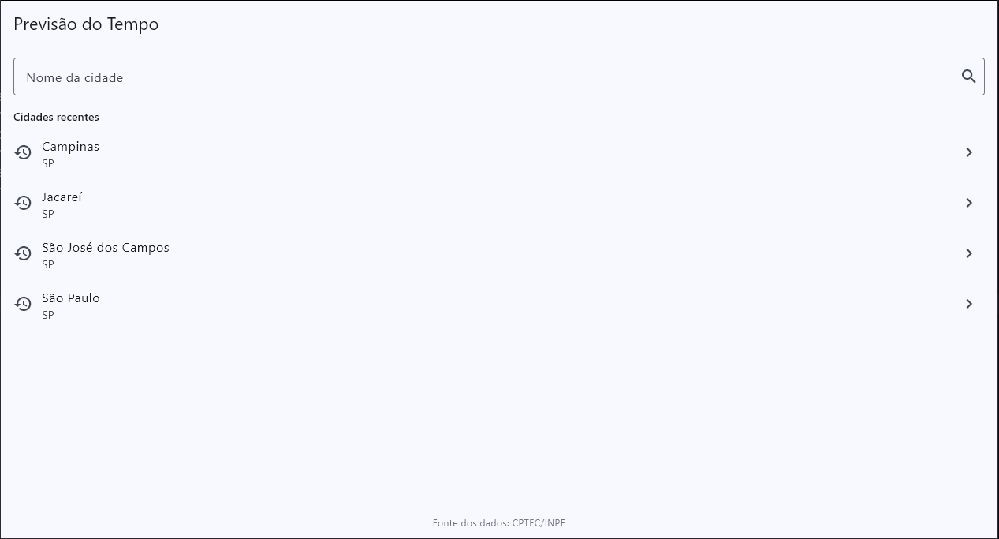
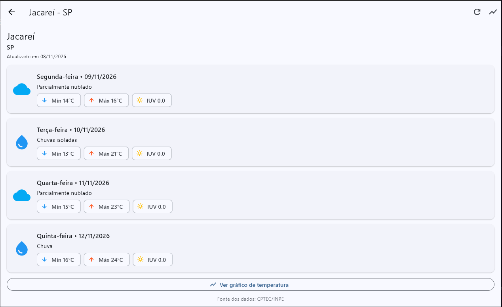
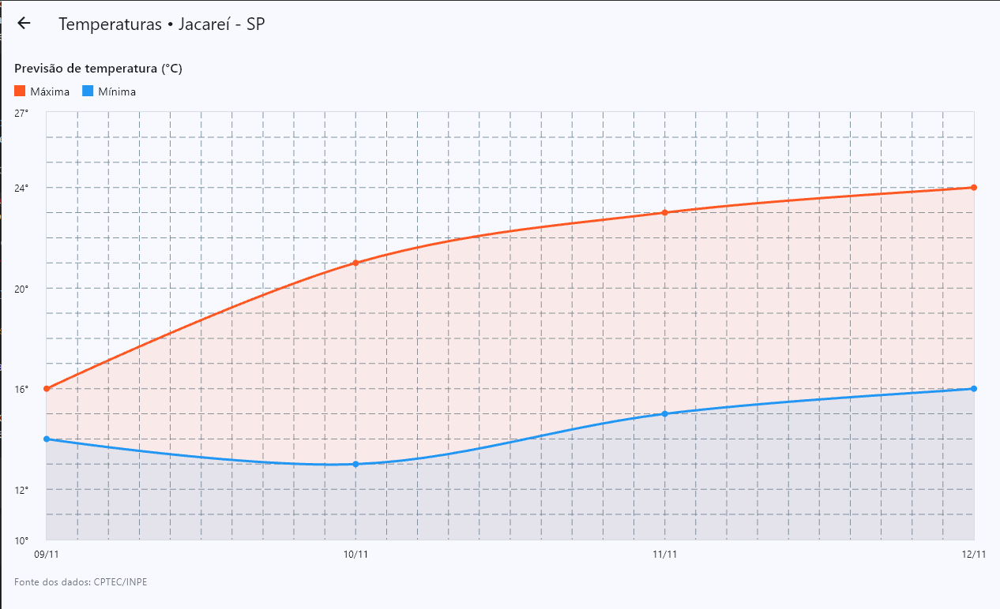

# Previsão do Tempo – CPTEC/INPE

Aplicativo **Flutter** que consulta a previsão do tempo de cidades brasileiras usando o webservice XML do **CPTEC/INPE**.

> Atividade 2 – Programação para Dispositivos Móveis II (Fatec) – Prof. Arley
> **Fonte dos dados: CPTEC/INPE** – <http://servicos.cptec.inpe.br/XML/>

## Funcionalidades

- **Pesquisa de cidades**: o usuário digita o nome da cidade e o app consulta `listaCidades?city=<nome>`. Os resultados mostram **nome e UF** e permitem selecionar a localidade. O código usado na previsão é o **`id` retornado pelo próprio serviço**.
- **Previsão para 4 dias** (`/cidade/{id}/previsao.xml`), exibindo todos os dias retornados, cada um com:
  - data da previsão;
  - temperatura mínima e máxima em °C;
  - descrição da condição do tempo (as siglas, como `pn`, `ps`, `c`, são convertidas em texto conforme a documentação do CPTEC/INPE);
  - ícone representativo da condição;
  - índice ultravioleta (IUV), **quando disponível**.
- **Data de atualização** informada pelo serviço.
- **Gráfico de temperaturas** (linhas de mínima e máxima) em tela própria.
- **Navegação entre 3 telas**: Pesquisa → Previsão → Gráfico.
- **Atualização manual**: botão na barra superior e *pull-to-refresh*.
- **Indicador de carregamento** durante todas as consultas.
- **Tratamento de erros**:
  - nenhuma cidade encontrada;
  - falha de conexão / timeout (15 s);
  - serviço indisponível (HTTP diferente de 200);
  - resposta inválida (XML malformado ou estrutura inesperada);
  - mensagem adequada quando não há previsão disponível;
  - campos ausentes ou com valores `null`/`undefined` são tratados sem encerrar o app (viram `null` e a interface mostra "—" ou omite o campo).
- **Persistência local** (veja abaixo) com *fallback* offline.
- **Identificação da fonte** (“Fonte dos dados: CPTEC/INPE”) em todas as telas.

## Como executar

Pré-requisitos: [Flutter SDK](https://docs.flutter.dev/get-started/install) (Dart ≥ 3.3) e um emulador ou dispositivo.

```bash
# 1. Clone o repositório e entre na pasta
git clone
cd previsao_tempo

# 2. Gere as pastas de plataforma (android/, ios/ ...) – não sobrescreve lib/ nem pubspec.yaml
flutter create --project-name previsao_tempo .

# 3. Instale as dependências
flutter pub get

# 4. Execute
flutter run
```

## Bibliotecas utilizadas

| Pacote | Uso |
|---|---|
| [`http`](https://pub.dev/packages/http) | Requisições HTTP ao serviço do CPTEC/INPE |
| [`xml`](https://pub.dev/packages/xml) | Interpretação das respostas em XML |
| [`shared_preferences`](https://pub.dev/packages/shared_preferences) | Persistência local de dados |
| [`fl_chart`](https://pub.dev/packages/fl_chart) | Gráfico de temperaturas |

## Estratégia de persistência local

Usa **`shared_preferences`** (armazenamento chave/valor), guardando objetos serializados em JSON:

| Chave | Conteúdo | Finalidade |
|---|---|---|
| `selected_city` | Última cidade selecionada (id, nome, UF) | Lembrar a seleção do usuário |
| `recent_cities` | Até 8 cidades pesquisadas recentemente (sem duplicatas) | Exibida na tela inicial para acesso rápido |
| `forecast_<id>` | Última previsão obtida com sucesso para a cidade | **Cache offline**: se a consulta falhar (sem internet, serviço fora do ar), o app exibe os dados salvos com um aviso indicando a data em que foram gravados |

Dados corrompidos ou ilegíveis no armazenamento são ignorados (o app não quebra).

## Estrutura do projeto

```
lib/
├── main.dart
├── models/        city.dart, forecast.dart
├── services/      cptec_service.dart (HTTP), cptec_parser.dart (XML),
│                  storage_service.dart (persistência), app_exceptions.dart
├── screens/       search_screen.dart, forecast_screen.dart, chart_screen.dart
├── widgets/       day_card.dart, message_view.dart, source_footer.dart
└── utils/         weather_condition.dart (siglas → descrição/ícone),
                   date_utils.dart, text_utils.dart
```

### Telas principais do aplicativo



